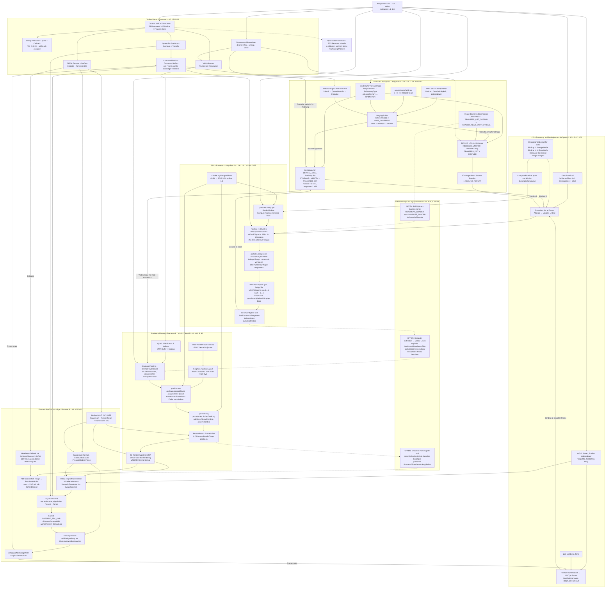
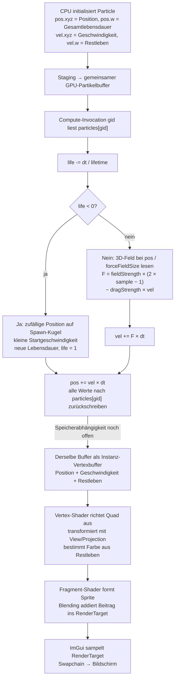
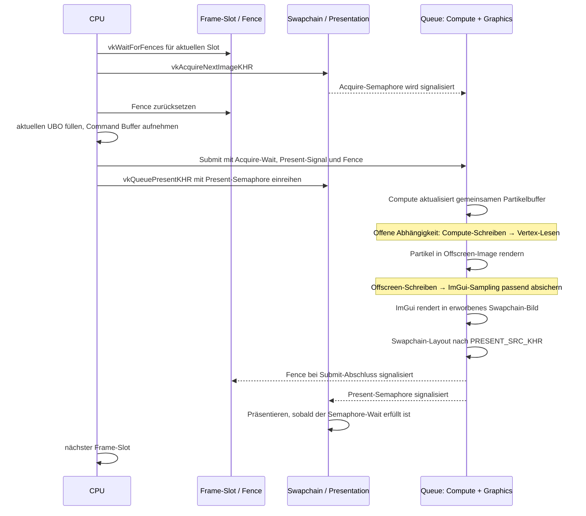

# CRAT3R: Zusammenhangsgraph des implementierten Stands

Stand: 02.11.2026. Grundlage sind die vorhandenen C++-/GLSL-Quellen in `a01/crat3r`, die Vorlesungsfolien in `ppp` und das Aufgabenblatt `a01/a01.pdf`. Dies ist eine statische Codeanalyse, kein Nachweis eines fehlerfreien GPU-Laufs.

Die Aufgaben 1.1 bis 1.8 sind im Quelltext umgesetzt. Die noch vorhandenen TODO-Kommentare beschreiben überwiegend bereits ausgefüllte Aufgaben. Das Aufgabenblatt bezeichnet Vulkan-Basis und Partikelrenderer ausdrücklich als bereitgestelltes Framework; eine Zuordnung einzelner Änderungen zu Personen wird hier nicht vorgenommen.

## Gesamtgraph

Durchgezogene Pfeile zeigen vorhandene Datenflüsse, Aufrufe oder Abhängigkeiten, keine automatisch garantierte Synchronisation. Gestrichelte Pfeile kennzeichnen offene Synchronisationsbezüge oder in a01 inaktive Erweiterungen. `VL #02, S. 63` bedeutet Vorlesungsdatei Nummer 02, PDF-Seite 63.

## So hängen die entscheidenden Vorlesungsthemen zusammen

| Thema | Konkrete Umsetzung und Zusammenhang | Folienbezug |
| --- | --- | --- |
| Explizite Vulkan-API | Handles, CreateInfo-Strukturen, `sType`, Feature-Ketten über `pNext`, `VK_CHECK`, explizites Aufräumen | VL #01, S. 7–14 |
| Instance, Device, Queue | `Context` lädt Vulkan über Volk, wählt bevorzugt eine diskrete GPU, erstellt Device und Queue; `VulkanApp` verwendet eine Queue mit Graphics-, Compute- und Transfer-Fähigkeit | VL #02, S. 6–9 |
| Command Buffers | Compute, Zeichnen und ImGui werden im normalen Fensterbetrieb in denselben Frame-Command-Buffer aufgenommen; zusätzliche einmalige Command Buffers übernehmen Uploads | VL #02, S. 8–12; VL #03, S. 74–75 |
| Buffer und Speicher sind getrennte Objekte | `createBuffer`: Buffer anlegen → Requirements abfragen → passenden Speichertyp finden → Speicher reservieren → binden | VL #02, S. 48–59 |
| Host-Speicher gegenüber GPU-Speicher | Staging und UBO sind host-visible/coherent; Partikelpuffer und Kraftfeld sind device-local. Die Usage-Flags beschreiben die erlaubten Verwendungen | VL #02, S. 49, 55–63 |
| Staging und Lebensdauer | CPU schreibt Upload-Buffer; GPU kopiert in Buffer bzw. Image. Der Transfer-Helper wartet auf die Queue, bevor der temporäre Buffer freigegeben wird | VL #02, S. 63; VL #03, S. 47, 75 |
| VMA | Framework verwaltet Quad-/Indexbuffer, RenderTarget und Readback-Buffer über VMA. Die Aufgabenressourcen benutzen bewusst manuelles `vkAllocateMemory` | VL #02, S. 64–68; Aufgabenblatt S. 2 |
| Descriptor Pool, Layout und Set | Pool stellt Kapazität bereit; Layout legt Typen und Bindings fest; Set verweist auf konkrete Ressourcen. Das Compute-PipelineLayout referenziert dieses Layout | VL #02, S. 27, 32–42 |
| Drei Compute-Bindings | Set 0: Binding 0 = gemeinsam beschreibbarer Partikelbuffer; Binding 1 = Parameter-UBO des aktuellen Frames; Binding 2 = 3D-ImageView plus Sampler | VL #02, S. 32–42; VL #03, S. 45–46 |
| Compute-Pipeline und SPIR-V | CMake kompiliert mit `glslangValidator`; die Anwendung lädt SPIR-V, erzeugt ShaderModule und Pipeline und zerstört danach das temporäre ShaderModule | VL #01, S. 7; VL #02, S. 13–18 |
| Workgroups und Invocations | 65.536 Partikel / 256 lokale Invocations = 256 Workgroups. `gl_GlobalInvocationID.x` identifiziert das Partikel; eine Bereichsprüfung verhindert Zugriffe über die Partikelzahl hinaus | VL #02, S. 3–5, 19–24 |
| Frames in Flight | Je Frame existieren Command Buffer, UBO und Compute-DescriptorSet. Der Partikelbuffer und das Kraftfeld werden gemeinsam referenziert. Der Fence schützt die Wiederverwendung des CPU-beschriebenen Frame-Slots | VL #02, S. 44–45; VL #03, S. 73–74 |
| Push Constants | Der Renderer übergibt View- und Projektionsmatrix als zwei `mat4`, zusammen 128 Byte, direkt im Command Buffer an den Vertex-Shader | VL #02, S. 27–30 |
| Image, ImageView und Sampler | Image enthält die 3D-Texel, View beschreibt den Zugriff, Sampler bestimmt Filterung und Adressierung. Die drei Rollen werden über den Combined-Image-Sampler-Deskriptor zusammengeführt | VL #03, S. 4–10, 23–25, 32–38, 45–47 |
| Format und Tiling | Das Kraftfeld verwendet `R8G8B8A8_UNORM` mit optimalem Tiling. Im Shader wird der gelesene Wertebereich 0…1 auf −1…1 umgerechnet; die Texel repräsentieren Vektoren | VL #03, S. 9–10 |
| Layout gegenüber Deskriptor | Die Upload-Barriere wechselt das Image-Layout. `VkDescriptorImageInfo.imageLayout` beschreibt anschließend das erwartete Layout; ein Descriptor-Update führt keinen Layoutwechsel aus | VL #03, S. 26–27, 46–47, 63–65 |
| Synchronisation | Fences synchronisieren mit dem Host; Semaphoren verbinden Acquire/Submit/Present; Barrieren und Subpass-Abhängigkeiten müssen die tatsächlichen Ressourcenzugriffe absichern | VL #03, S. 50–76 |
| Swapchain und WSI | GLFW erstellt die Surface; Swapchain wählt Format, Bildgröße, Bildanzahl und Present Mode. Nach Acquire rendert ImGui ins Swapchain-Bild, danach folgt Present | VL #03, S. 78–89 |
| Resize | Neue Fenstergröße bzw. `OUT_OF_DATE` löst Rebuild aus; Swapchain-Views, RenderTarget und Partikel-Framebuffer werden erneuert. Minimierte Fenster werden abgewartet | VL #03, S. 90–91 |
| Rasterisierung im vorhandenen Framework | Instanziierte Quads, Vertex-/Fragment-Shader, RenderPass, Framebuffer und additives Blending sind bereits im Renderer vorhanden | VL #02, S. 2, 26, 31; in VL #03, S. 92 als nächste Vorlesung angekündigt |

## Zoom: Ein Partikel vom Speicher bis zum Pixel

Die Grafikpipeline liest den Partikelbuffer über Vertex-Attribute, nicht über das Compute-DescriptorSet. Der Renderer kombiniert einen Quad-Vertexbuffer mit einem Partikelbuffer mit `VK_VERTEX_INPUT_RATE_INSTANCE` und zeichnet sechs Indizes für jede der 65.536 Instanzen. Die CPU liest die simulierten Partikel nicht zurück.

## Zoom: Frame-Synchronisation

Ein Fence pro Frame ersetzt keine Speicherbarriere zwischen Compute und Vertex-Input. Ebenso bedeutet `HOST_COHERENT`, dass explizites Flushen des Host-Speichers entfällt; eine vorzeitige Wiederverwendung des Buffers wird dadurch nicht erlaubt. Das sind zwei verschiedene Probleme aus VL #02, S. 45 und VL #03, S. 50–57.

## Offene Verbindungen aus VL #03

Diese Punkte beschreiben den analysierten Stand; der Anwendungscode wurde für diesen Graphen nicht geändert.

1. **Partikelbuffer: Compute → Vertex-Input.** Nach `vkCmdDispatch` folgt der Partikelrenderer ohne passende globale oder Buffer-Speicherbarriere. Die benötigte Abhängigkeit verbindet `COMPUTE_SHADER / SHADER_WRITE` mit `VERTEX_INPUT / VERTEX_ATTRIBUTE_READ`. Zusätzlich müssen frühere Vertex-Lesezugriffe und Compute-Zugriffe vor dem nächsten Überschreiben bzw. Lesen des gemeinsamen Buffers geordnet sein. Die Reihenfolge von Befehlen auf derselben Queue allein gewährleistet diese Speicherabhängigkeiten nicht. Beleg: [Dispatch und Frame-Aufruf](C:/git/crat3r/a01/crat3r/src/a01/main.cpp:624), [Vertexbuffer-Bindung](C:/git/crat3r/a01/crat3r/src/a01/particle_renderer.cpp:108); VL #03, S. 50–62.
2. **Kraftfeld: Transfer → Compute-Sampling.** `transitionImageLayout` setzt für `SHADER_READ_ONLY_OPTIMAL` die Zielstufe auf `FRAGMENT_SHADER`, während der tatsächliche Leser hier `particles.comp` ist. Die Barriere bildet den Compute-Lesezugriff damit nicht passend ab. Beleg: [Layout-Helper](C:/git/crat3r/a01/crat3r/src/a01/main.cpp:775); VL #03, S. 57, 63–65.
3. **Offscreen-Image: Partikelrendering → ImGui-Sampling → erneutes Rendering.** Der RenderPass endet im Shader-Read-Layout, hat aber nur eine explizite Eingangsabhängigkeit mit `TOP_OF_PIPE` und `MEMORY_READ`. Diese Access-/Stage-Kombination passt nicht; außerdem fehlt eine passend beschriebene Farb-Schreiben-zu-Fragment-Lesen-Abhängigkeit. Auch die Wiederverwendung des einzelnen Offscreen-Images über Frames muss den vorherigen Lesezugriff berücksichtigen. Beleg: [RenderPass](C:/git/crat3r/a01/crat3r/src/a01/particle_renderer.cpp:125), [ImGui-Ausgabe](C:/git/crat3r/a01/crat3r/src/core/vulkan_app.cpp:708); VL #03, S. 50–60, 63.

## Weitere vorhandene Bestandteile und ihre Rolle

| Bestandteil | Verbindung und Einordnung |
| --- | --- |
| `Fs::readFile` / `findPath` | Liefert SPIR-V und Vektorfelddaten; sucht relativ zum Arbeitsverzeichnis oder zum einkompilierten Projektverzeichnis |
| `VK_CHECK`, `VK_CHECK_RETURN`, `vk_string.hpp` | Übersetzen negative Vulkan-Ergebnisse in nachvollziehbare Fehler mit Ausdruck, Datei und Zeile; ergänzen die Validation Layers |
| `volk_impl.cpp`, `vma_impl.cpp`, `stb_impl.cpp` | Binden die Implementierungen für Vulkan-Funktionsladen, Speicherverwaltung und Bild-I/O in das Projekt ein |
| GLM | Vektoren für Partikeldaten, Kameramathematik und Matrizen für Push Constants |
| Performance-Anzeige | ImGui zeigt Framezeit/FPS und gemessene CPU-Zeit; kein GPU-Timestamp-Profiler implementiert |
| Screenshot | Liest das Offscreen-RenderTarget über einen Transfer-Buffer zurück und schreibt PNG über stb in einem Thread; kein RenderDoc-Capture |
| Headless-Fallback | Bei fehlgeschlagenem GLFW-Start vorhandener alternativer Ablauf mit einem Frame-Slot, Queue-Wait nach jedem Frame und Screenshots alle zehn Frames; Ausführung hier nicht geprüft |
| Kamera | Orbit-Modus ist für a01 aktiv; First-Person-Steuerung ist im Framework vorhanden |
| `Timer` | Einfacher CPU-Zeitmesser in `timer.hpp`, im aktuellen Anwendungspfad nicht benutzt |
| Raytracing und Audio | Optionales Aktivieren von RTX-Extensions/Features und ein daran gekoppelter Audio-Pfad sind im Framework vorhanden. a01 ruft `enableRTX()` nicht auf; keine implementierte Raytracing-Szene oder Raytracing-Pipeline in a01 |
| Assimp, OpenMP und GLB-Assets | Build-Abhängigkeiten bzw. vorhandene Assets; im aktiven Partikelpfad kein Modellimport und keine entsprechende Szene implementiert |
| a02–a04 | CMake enthält bedingte Zieldefinitionen, aber die zugehörigen Aufgabenquellen fehlen im untersuchten Stand |
| Andere Folienthemen | Specialization Constants, Shared-Memory-Algorithmen, Mipmap-Erzeugung, Texturkompression, anisotropes Sampling und Vulkan-Events werden in den Folien behandelt, sind hier aber nicht als aktive Anwendungstechniken umgesetzt. Das Kraftfeld hat ein Mip-Level |
| RenderDoc / Nsight | In VL #01 genannte externe Analysewerkzeuge; ihre tatsächliche Nutzung ist aus diesem Quelltext nicht nachweisbar |

## Quellen und Einstiegspunkte

Die Seitenangaben oben beziehen sich auf die PDF-Seiten einschließlich Titelseite.

- [VL #00: Organisation](C:/git/crat3r/ppp/Crat3r%20%2300%20-%20Organisation.pdf), S. 3–6: Kursrahmen und geplante Themen; keine zusätzliche implementierte Programmfunktion.
- [VL #01: Introduction to Vulkan and GPU Debugging](C:/git/crat3r/ppp/Crat3r%20%2301%20-%20Introduction%20to%20Vulkan%20and%20GPU%20Debugging.pdf).
- [VL #02: Compute Shaders, Descriptors, Buffers and Memory](C:/git/crat3r/ppp/Crat3r%20%2302%20-%20Compute%20Shaders,%20Descriptors,%20Buffers%20and%20Memory.pdf).
- [VL #03: Images, Synchronization and the Swap-Chain](C:/git/crat3r/ppp/Crat3r%20%2303%20-%20Images,%20Synchronization%20and%20the%20Swap-Chain.pdf).
- [Aufgabenblatt a01](C:/git/crat3r/a01/a01.pdf), besonders S. 2–4: Framework-Abgrenzung und Aufgaben 1.1–1.8.
- [Aufgabenimplementierung](C:/git/crat3r/a01/crat3r/src/a01/main.cpp), [Compute-Shader](C:/git/crat3r/a01/crat3r/shaders/a01/particles.comp), [gemeinsames Partikelformat](C:/git/crat3r/a01/crat3r/src/a01/particle.h).
- [Partikelrenderer](C:/git/crat3r/a01/crat3r/src/a01/particle_renderer.cpp), [Vertex-Shader](C:/git/crat3r/a01/crat3r/shaders/a01/particle.vert), [Fragment-Shader](C:/git/crat3r/a01/crat3r/shaders/a01/particle.frag).
- [VulkanApp](C:/git/crat3r/a01/crat3r/src/core/vulkan_app.cpp), [Context](C:/git/crat3r/a01/crat3r/src/core/context.cpp), [Swapchain](C:/git/crat3r/a01/crat3r/src/core/swapchain.cpp).
- [Build](C:/git/crat3r/a01/crat3r/CMakeLists.txt), [Shader-Kompilierung](C:/git/crat3r/a01/crat3r/shaders/CMakeLists.txt).
